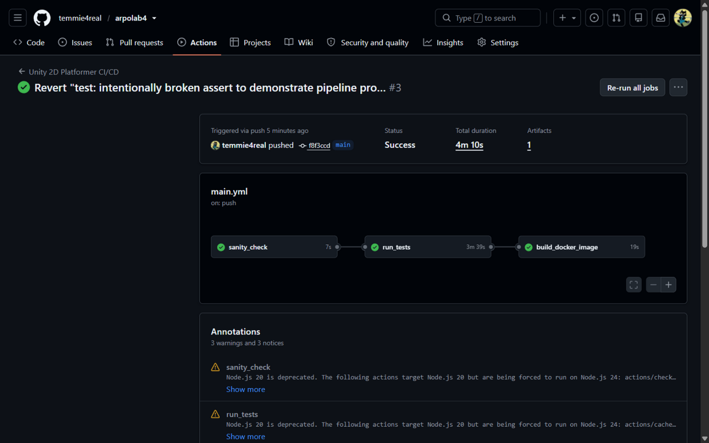
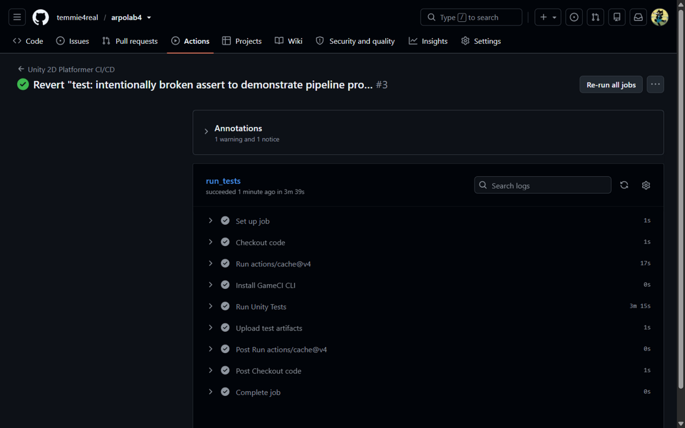
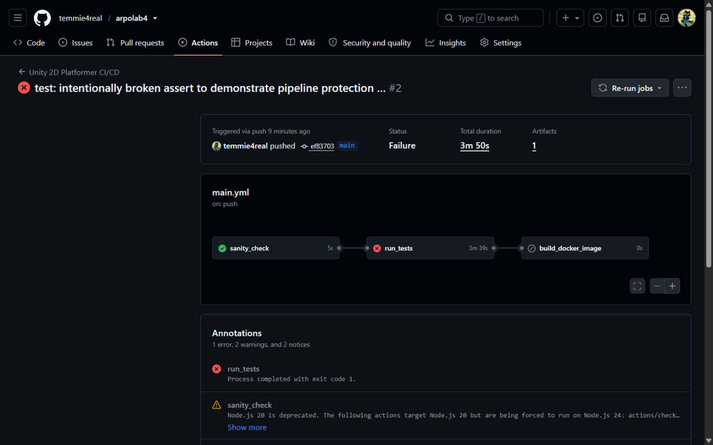
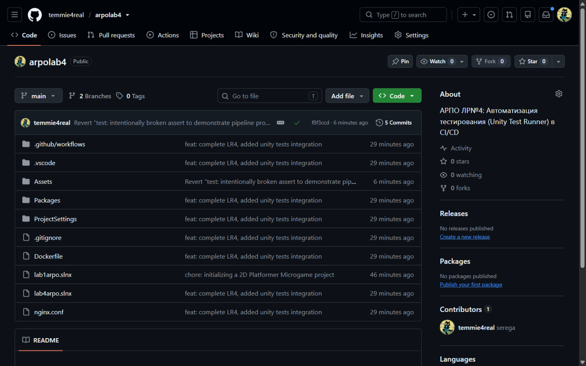

# Лабораторная работа №4. Автоматизация тестирования (Unity Test Runner) в CI/CD

Студент: Сергей Шнитко

Репозитории:
- https://github.com/temmie4real/arpolab4 (текущий)
- https://github.com/temmie4real/arpolab3 (ЛР №3)
- https://github.com/temmie4real/arpolab1 (ЛР №1, ЛР №2)

Цель работы: настроить автоматический запуск Unity-тестов (EditMode и PlayMode) в облачном пайплайне так, чтобы облачная компиляция игры и сборка Docker-образа выполнялись только при успешном прохождении всех тестов.

Индивидуальный вариант: **№20** — PlayMode-тест для механики `Simulation` (`Assets/Scripts/Core/Simulation.cs`): **запланированное событие выполняется после `Tick()`**.

## Ход работы

### Шаг 1: Разделение кодовой базы (Assembly Definitions)

Создал три файла Assembly Definition, разделившие кодовую базу на изолированные модули:

- `Assets/Scripts/GameAssembly.asmdef` — игровая сборка (весь код игры).
- `Assets/Tests/EditMode/Tests.asmdef` — тестовая сборка EditMode, создана через Test Runner (`includePlatforms: ["Editor"]`).
- `Assets/Tests/PlayMode/PlayModeTests.asmdef` — тестовая сборка PlayMode (без ограничения платформ).

В обеих тестовых сборках в разделе Assembly Definition References добавил ссылку на `GameAssembly` — теперь тесты видят код игры, а сами тестовые библиотеки не попадают в финальную сборку (`overrideReferences: true` + `nunit.framework.dll`, `defineConstraints: UNITY_INCLUDE_TESTS`).

Нюанс, с которым пришлось столкнуться: после выноса кода игры в отдельную сборку `GameAssembly` она потеряла автоматические ссылки на пакеты — компиляция упала с ошибками `UnityEngine.InputSystem does not exist` и `Unity.Cinemachine does not exist`. Починил, добавив в `references` файла `GameAssembly.asmdef` сборки `Unity.InputSystem` и `Unity.Cinemachine`.

### Шаг 2: Написание автоматических тестов

Три теста в папке `Assets/Tests/`:

1. **`Assets/Tests/EditMode/PlayerTests.cs`** (EditMode) — открывает сцену `Assets/Scenes/SampleScene.unity` через `EditorSceneManager` и проверяет: объект игрока `Player` существует, тег `Player` не сброшен, на объекте есть компоненты `PlayerController` и `Health`.

2. **`Assets/Tests/PlayMode/PlayerHealthTests.cs`** (PlayMode) — создает временный объект с реальным скриптом `Health` из игры, задает 3 хитпоинта до активации (`Awake` выставит `currentHP = maxHP`), наносит три урона через `Decrement()` и проверяет, что после первых двух персонаж жив (`IsAlive == true`), а после третьего — погиб (`IsAlive == false`).

3. **`Assets/Tests/PlayMode/SimulationTests.cs`** (PlayMode, индивидуальный вариант №20) — тест дискретного планировщика событий:

```csharp
// Тестовое событие: при выполнении Execute() выставляет статический флаг
private class TestEvent : Simulation.Event
{
    public static bool Executed;
    public override void Execute() { Executed = true; }
}

// Планируем событие через 1.5 секунды игрового времени
Simulation.Clear();
TestEvent.Executed = false;
TestEvent scheduled = Simulation.Schedule<TestEvent>(1.5f);
Assert.IsFalse(TestEvent.Executed);      // до срока и до Tick() событие не выполняется

yield return new WaitForSeconds(2f);     // ждем 2 секунды — срок наступил
Assert.IsFalse(TestEvent.Executed);      // но без Tick() симулятор ничего не выполняет

int remaining = Simulation.Tick();       // Tick() выполняет «созревшие» события
Assert.IsTrue(TestEvent.Executed);       // событие выполнилось после Tick()
Assert.AreEqual(0, remaining);           // очередь опустела
```

Статический флаг выбран вместо экземплярного намеренно: `Simulation` переиспользует события через пул объектов, и экземплярный флаг «пережил» бы повторное использование объекта из пула при повторном запуске теста.

### Шаг 3: Локальный запуск тестов

Прогнал оба режима через Unity Test Runner (CLI): **все 3 теста зеленые** — `EditMode_PlayerTag_IsCorrect`, `PlayMode_PlayerTakesDamage_HealthDecreases`, `PlayMode_ScheduledEvent_ExecutesAfterTick`.

### Шаг 4: Настройка автоматического запуска тестов в GitHub Actions

В `.github/workflows/main.yml` добавил задачу `run_tests` (между `sanity_check` и `build_docker_image`):

- Официальный **CLI GameCI** (v0.1.72) скачивается и запускает тесты в контейнере `unityci/editor` сразу в двух режимах: `--testPlatforms='playmode;editmode;COMBINE_RESULTS'`, результаты сохраняются артефактом `test-results` (`if: always()`).
- Версия Unity передается явно (`--engineVersion=6000.3.10f1`), потому что `ProjectSettings/ProjectVersion.txt` исключен `.gitignore`.
- `--coverageEnabled=false` — инструментирование кода роняет Unity 6 в контейнере (SIGSEGV), поэтому CLI вызывается напрямую, а не через экшен `game-ci/unity-test-runner@v4`.
- Кэш папки `Library` через `actions/cache@v4` ускоряет повторные прогоны (импорт ассетов выполняется один раз).
- Лицензия: для Unity 6 контейнер активирует бесплатную Personal-лицензию по секретам `UNITY_EMAIL` и `UNITY_PASSWORD` (созданы в Settings → Secrets and variables → Actions). Файл `.ulf` не используется — Unity отключила ручную активацию Personal-лицензий, а локальный файл лицензии привязан к железу и в контейнере не работает.
- Цепочка гейта качества: `build_docker_image: needs: run_tests` — сборка Docker-образа начинается **только** после успешных тестов.

### Шаг 5: Проверка результатов и демонстрация защиты пайплайна

После влития PR пайплайн прошел полностью зеленый: `sanity_check` → `run_tests` (3 мин 39 с, артефакт test-results) → `build_docker_image`:





Демонстрация защиты (шаг 5.3 методички): временно изменил логику теста на заведомо ложную (`Assert.AreEqual(1, 2)`), выполнил пуш — задача `run_tests` упала, а `build_docker_image` даже не запустилась (статус skipped): сломанный коммит автоматически заблокирован и не доходит до сборки и публикации. Затем вернул исправленный вариант — пайплайн снова зеленый:



Отчет по лабораторной работе размещен в README основного репозитория:



## Результаты

- Кодовая база разделена на модули Assembly Definitions, тестовые сборки изолированы от финальной сборки игры.
- 3 теста (1 EditMode + 2 PlayMode, включая индивидуальный вариант №20) проходят локально и в облаке.
- Пайплайн GitHub Actions: `sanity_check` → `run_tests` (GameCI, EditMode + PlayMode) → `build_docker_image` (GHCR); падение любого теста автоматически блокирует сборку и публикацию.
